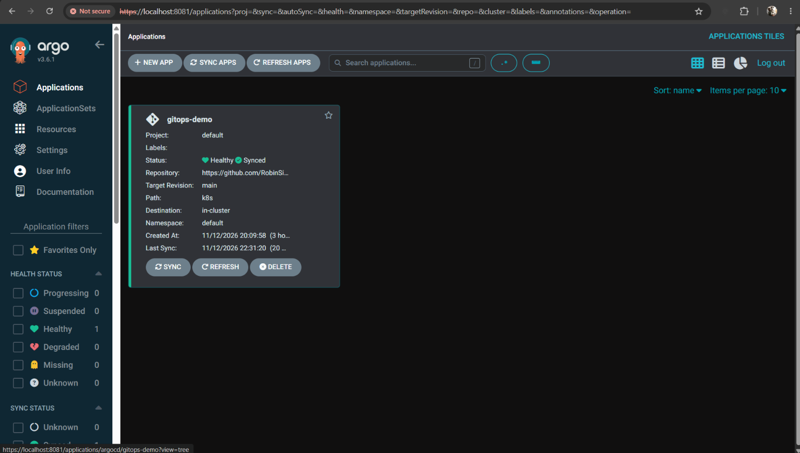
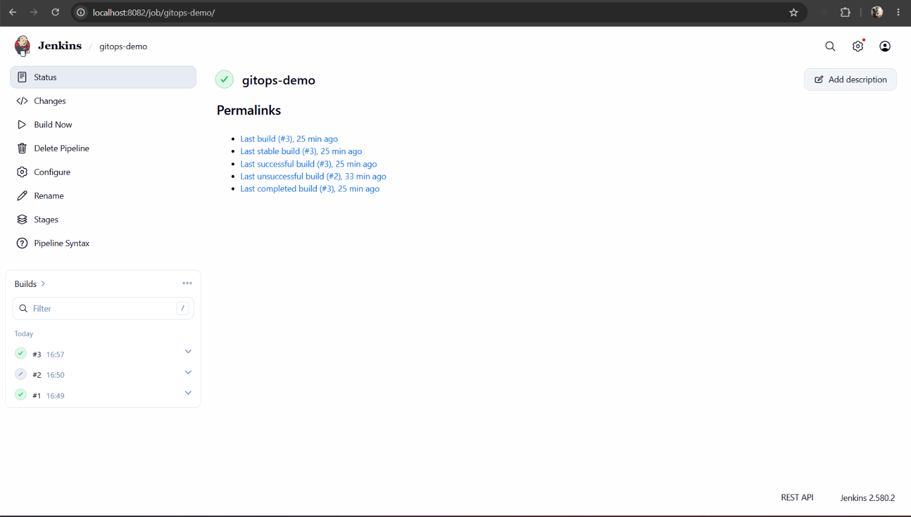
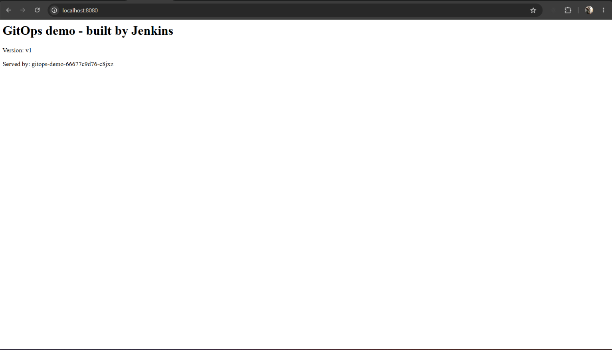

# GitOps on Kubernetes with ArgoCD and Jenkins

A small end-to-end GitOps pipeline: a code push is built into a Docker image by Jenkins, the new image tag is committed back to Git, and ArgoCD deploys it to Kubernetes automatically. Git is the single source of truth, and manual changes to the cluster are reverted.

Currently runs on a local [kind](https://kind.sigs.k8s.io/) cluster. Moving it to AWS EKS with Terraform is planned.

## How it works

```
 git push (app code)
        |
        v
  Jenkins pipeline
   1. build Docker image
   2. push image to Docker Hub (tag = build number)
   3. commit the new tag into k8s/deployment.yaml
        |
        v
  GitHub repo (source of truth)
        |
        v
  ArgoCD watches k8s/ and syncs the cluster
        |
        v
  Kubernetes runs 3 replicas of the app
```

## Stack

| Piece | Tool |
|---|---|
| App | Python / Flask |
| Container | Docker, Docker Hub |
| Orchestration | Kubernetes (kind, local) |
| CD | ArgoCD (automated sync, prune, self-heal) |
| CI | Jenkins (declarative pipeline, `Jenkinsfile`) |

## Repo layout

| Path | What it is |
|---|---|
| `app/` | Flask app, `requirements.txt`, `Dockerfile` |
| `k8s/` | Kubernetes `Deployment` and `Service` |
| `argocd-app.yaml` | ArgoCD `Application` that watches `k8s/` |
| `Jenkinsfile` | Build, push and manifest-update pipeline |
| `docs/` | Screenshots |

## What I verified

- **Self-healing:** deleting a pod, or scaling the Deployment down by hand, is undone automatically (Kubernetes restores deleted pods, ArgoCD reverts the manual scale).
- **GitOps deploy:** changing `replicas` from 2 to 3 in Git scaled the cluster with no `kubectl apply`.
- **Full loop:** editing `app/app.py` and running the Jenkins job led to a new image on Docker Hub, a Jenkins commit updating the image tag, and ArgoCD rolling out the new pods.

### ArgoCD: Healthy and Synced



### Jenkins: successful build



### The deployed app after a pipeline run



## Run it locally

Prerequisites: Docker, `kubectl`, `kind`.

```bash
kind create cluster --name gitops
kubectl create namespace argocd
kubectl apply -n argocd --server-side -f https://raw.githubusercontent.com/argoproj/argo-cd/stable/manifests/install.yaml
kubectl apply -f argocd-app.yaml
```

Open ArgoCD with `kubectl port-forward svc/argocd-server -n argocd 8081:443`, and the app with `kubectl port-forward svc/gitops-demo 8080:80`.

Jenkins runs as a container (`jenkins/jenkins:lts-jdk21`) with the Docker socket mounted. It needs two credentials: `dockerhub` and `github` (a fine-grained token with Contents read/write on this repo).

## Notes and limits

- The Jenkins job is started manually; there is no webhook trigger yet.
- Jenkins runs as root with the Docker socket mounted. That is fine for a local lab, not for production.
- ArgoCD uses a self-signed certificate locally.

## Roadmap

- [ ] Provision EKS with Terraform and run the same GitOps flow on AWS
- [ ] GitHub webhook to trigger Jenkins on push
